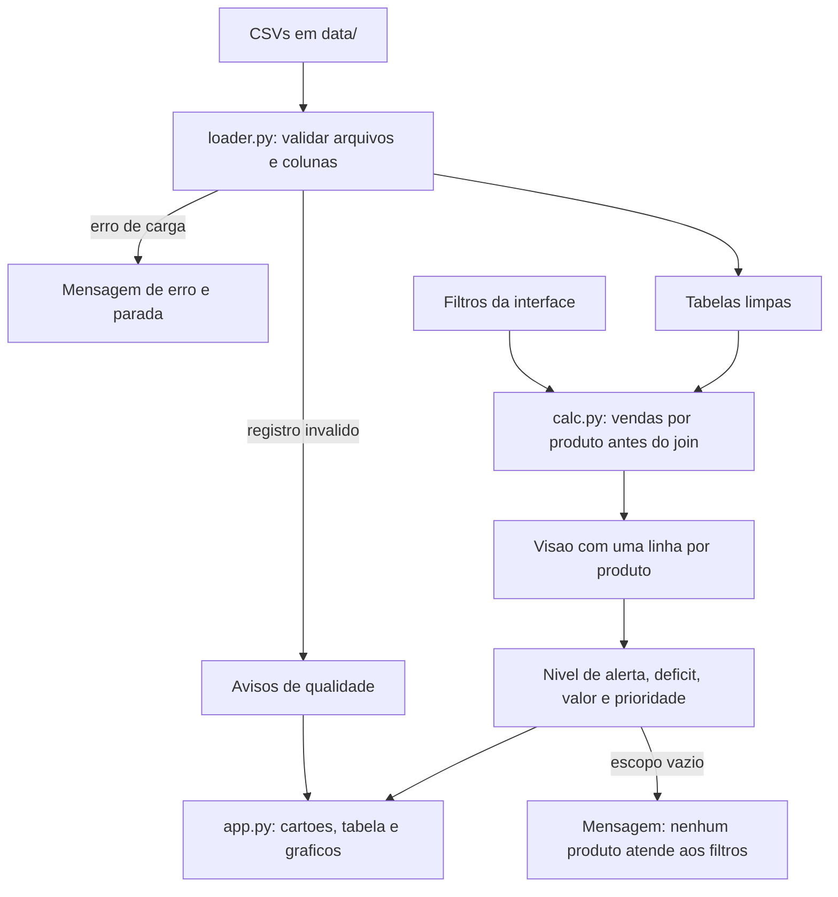

# SPEC — Software Specification

> **Objetivo:** transformar os requisitos do produto em uma especificação verificável, que oriente o planejamento, a implementação e a validação do software.
>
> **Documento de referência do SDD:** esta especificação é a fonte de verdade para os requisitos técnicos e comportamentais aprovados.

## 1. Metadados

- **Projeto:** Dashboard de Estoque e Apoio à Reposição de Produtos — Garden Shop
- **Versão da especificação:** 1.0 (implementado)
- **PRD relacionado:** `PRD.md` (versão 1.1)
- **Responsável pela aprovação:** Júlia Maria de Carvalho Vale
- **Data:** 2026-10-27

> Documento redigido com apoio de IA generativa (Claude).

## 2. Objetivo técnico

O sistema lê os CSVs originais da Garden Shop, valida-os, consolida **uma linha por produto** (estoque, nível de reposição, custo, categoria, fornecedor e vendas efetivas), aplica as regras de negócio do PRD e exibe em uma única página: cartões de indicadores, tabela de prioridade de reposição, quatro gráficos por produto ou categoria e avisos de contexto, com filtros que recalculam tudo.

Limites técnicos relevantes:

- **Somente leitura:** os CSVs nunca são alterados e nada é gravado.
- **Estoque é a posição atual** (`quantity_on_hand`); status do pedido e período filtram só as vendas (RN-009).
- **Sem histórico de estoque e sem prazo de entrega:** nenhum cálculo de giro, cobertura, previsão ou quantidade de compra.
- **Tabela `customers` não é carregada.**
- Volume pequeno (24 produtos e 48 itens de pedido): sem requisito de desempenho além de responder a um filtro sem espera perceptível.

## 3. Referências e rastreabilidade

| Requisito do PRD | Requisito da SPEC | Critério de validação |
| --- | --- | --- |
| RNF-001, RNF-002, seção 8 do PRD | REQ-001 | TEST-001 a TEST-005 |
| RN-011, RF-004 | REQ-002 | TEST-006, TEST-007 |
| RN-001, RN-002, RN-009, RF-005, RF-007, RF-012, RF-014 | REQ-003 | TEST-008 a TEST-013 |
| RN-003, RN-004, RN-005, RN-007, RF-001, RF-002, RF-003, RF-006, RF-013 | REQ-004 | TEST-014 a TEST-019 |
| RN-006, RF-004, RF-018 | REQ-005 | TEST-020, TEST-021 |
| RF-009, RF-010, RF-011, RF-014, RF-015, RF-023 | REQ-006 | TEST-022 a TEST-025 |
| RN-008, RN-010, RF-016 | REQ-007 | TEST-026 a TEST-029 |
| RF-001 a RF-008 | REQ-008 | TEST-030, TEST-031 |
| RF-017 a RF-021 | REQ-009 | TEST-032, TEST-033, VERIF-M-01 a VERIF-M-03 |
| RF-015, RF-022, RF-023, RNF-004, RNF-005, seção 10 do PRD | REQ-010 | TEST-034, VERIF-M-04 a VERIF-M-08 |
| RNF-003 | Seção 13 (estratégia de testes) | TEST-001 a TEST-037 |

Toda funcionalidade obrigatória (Must do PRD) é rastreável até um requisito desta SPEC. Os critérios de aceitação numéricos do PRD (seção 6) são reproduzidos nos testes de base completa (TEST-030 a TEST-037).

## 4. Escopo técnico

### 4.1. Incluído

- Carga e validação dos cinco CSVs (`products`, `categories`, `suppliers`, `orders`, `order_items`).
- Consolidação por produto, sem duplicar estoque nem valor.
- Cálculo de vendas efetivas, nível de alerta, déficit, valor do estoque e prioridade.
- Filtros: categoria, fornecedor, nível de alerta, status do pedido, período, incluir descontinuados e limpar filtros.
- Cartões, tabela de prioridade, quatro gráficos por produto ou categoria, dispersão e avisos.
- Testes automatizados sobre um recorte dos CSVs e sobre a base completa.

### 4.2. Excluído

- Cobertura em dias, giro, previsão, sugestão de quantidade de compra, curva ABC e margem.
- Uso de `customers.csv`, `shipped_date`, `coupon_code` e `price`.
- Duas abas, busca por produto, exportação, filtro cruzado por clique e cortes ajustáveis.
- Hospedagem, autenticação, banco de dados e escrita de dados.

## 5. Arquitetura proposta

### 5.1. Visão geral

A arquitetura separa **regra de negócio** (funções puras, sem interface) da **interface**. O carregador lê e valida os CSVs; o módulo de cálculo consolida, filtra, classifica e prioriza; a interface só desenha o que o cálculo devolve. Assim, as regras são testadas sem abrir o painel (RNF-003).

Tecnologia **proposta** (ADR-001, pendente de DP-001): Python, pandas, Streamlit, Plotly e pytest.

### 5.2. Componentes

| Componente | Responsabilidade | Entradas | Saídas |
| --- | --- | --- | --- |
| `src/loader.py` | Ler os CSVs, validar arquivos e colunas obrigatórias, converter tipos (datas e booleanos nos dois formatos), descartar registros inválidos | Pasta com os CSVs | `Dados` (cinco tabelas limpas) e lista de `avisos` de qualidade; erro de carga com mensagem específica |
| `src/calc.py` | **Todas** as regras de negócio: vendas efetivas, consolidação por produto, nível de alerta, déficit, valor, filtros, prioridade e indicadores | `Dados` e `Filtros` | Visão por produto, indicadores, tabela de prioridade, séries dos gráficos e avisos |
| `src/app.py` | Interface: ler filtros, chamar o cálculo e desenhar cartões, tabela, gráficos e mensagens | `Dados` e escolhas do usuário | Página do painel |
| `data/` | Cópias dos CSVs originais (não editar) | — | — |
| `tests/` | Testes das regras e do carregador | `tests/fixtures/` (recorte) e `data/` (base completa) | Resultado dos testes |

### 5.3. Fluxo de execução

1. A interface chama o carregador com a pasta `data/`.
2. Se houver erro de carga (arquivo ou coluna ausente), exibe a mensagem e **interrompe**, sem números.
3. Registros inválidos saem dos dados e entram em `avisos`.
4. A interface lê os filtros e monta o objeto `Filtros`.
5. `calc.py` filtra pedidos por status e período, exclui `cancelled`, **soma as vendas por produto** e só então relaciona o resultado ao cadastro (RN-011).
6. `calc.py` classifica o nível de alerta, calcula déficit, valor e prioridade e aplica os filtros de escopo.
7. A interface desenha cartões, tabela, gráficos e avisos; se o escopo ficar vazio, mostra a mensagem de filtro sem resultado.

### 5.4. Diagrama

## 6. Requisitos comportamentais

### REQ-001 — Carga e validação dos dados

- **Origem:** RNF-001, RNF-002 e seção 8 do PRD.
- **Descrição:** O sistema deve carregar os cinco CSVs, validar sua estrutura e converter os tipos, sem alterar os arquivos.
- **Pré-condições:** A pasta `data/` existe e contém `products.csv`, `categories.csv`, `suppliers.csv`, `orders.csv` e `order_items.csv`.
- **Entrada:** Caminho da pasta de dados.
- **Processamento:**
  - Verificar a existência de cada arquivo e das colunas obrigatórias (seção 7.1).
  - Converter `order_date` aceitando `AAAA-MM-DD` e `DD/MM/AAAA`; converter `discontinued` aceitando `true`/`false` e `TRUE`/`FALSE` (sem diferenciar maiúsculas).
  - Tratar `contact_email` vazio como ausente.
  - Descartar **sem corrigir** os registros inválidos: `order_items` com `product_id` ou `order_id` inexistente; quantidade, custo, estoque ou nível não numéricos; `quantity` ≤ 0; `quantity_on_hand` < 0; `reorder_level` ≤ 0; data de pedido inválida; `status` fora de `shipped`, `processing`, `pending`, `cancelled`.
  - Cada registro descartado gera um aviso com o arquivo, a linha ou chave e o motivo.
- **Saída:** `Dados` com as cinco tabelas limpas e a lista `avisos`.
- **Pós-condições:** Os arquivos em disco permanecem idênticos aos originais.
- **Erros e exceções:** Arquivo ausente gera `ErroDeCarga("arquivo ausente: <nome>")`; coluna ausente gera `ErroDeCarga("coluna ausente: <coluna> em <arquivo>")`. A interface exibe a mensagem e não calcula nada.
- **Critérios de aceitação:**
  - Dado o recorte de testes, quando carregar, então há 7 produtos, 5 categorias, 5 fornecedores, 10 pedidos e 12 itens, sem avisos.
  - Dado um arquivo ou coluna removidos em memória, quando carregar, então o erro cita o arquivo ou a coluna.
  - Dado um item de pedido com produto inexistente criado em memória, quando carregar, então o item sai do cálculo e há um aviso.
  - Dadas datas em `DD/MM/AAAA` e booleanos em `TRUE`/`FALSE`, quando carregar, então são lidos corretamente.

### REQ-002 — Consolidação com uma linha por produto

- **Origem:** RN-011, RF-004.
- **Descrição:** O sistema deve montar a visão do produto com **uma única linha por `product_id`**, sem multiplicar estoque ou valor pelo número de itens de pedido.
- **Entrada:** Tabelas limpas e a tabela de vendas por produto (REQ-003).
- **Processamento:**
  1. Somar `quantity` por `product_id` na tabela de itens já filtrada e sem cancelados (REQ-003).
  2. Relacionar o resultado ao cadastro com `LEFT JOIN` a partir de `products` (produto sem venda recebe 0).
  3. Relacionar categoria e fornecedor por `LEFT JOIN`. Fornecedor sem e-mail fica com contato ausente.
  4. Nunca relacionar `products` com `order_items` antes da agregação.
- **Saída:** `VisaoProduto` (seção 7.1), com `len(visao) == len(products)` e `Σ quantity_on_hand` igual ao do cadastro.
- **Pós-condições:** A soma do estoque e do valor da visão é igual à do cadastro, em qualquer filtro de vendas.
- **Erros e exceções:** Categoria ou fornecedor inexistente: o produto permanece, com nome ausente exibido como "—", e gera aviso.
- **Critérios de aceitação:**
  - Dado Fiddle-Leaf Fig com 4 itens de pedido, quando consolidar, então aparece 1 vez, com valor US$ 252,00 (14 × 18) e 5 unidades vendidas.
  - Dada qualquer combinação de status e período, quando consolidar, então a soma do estoque da visão é igual à do cadastro.

### REQ-003 — Vendas efetivas por produto

- **Origem:** RN-001, RN-002, RN-009, RF-005, RF-007, RF-012, RF-014.
- **Descrição:** O sistema deve calcular, por produto, as unidades vendidas e as unidades em aberto, a partir dos itens de pedidos que passam pelos filtros de status e período.
- **Pré-condições:** Dados carregados (REQ-001).
- **Entrada:** `status_selecionados` (subconjunto de `shipped`, `processing`, `pending`), `data_inicio`, `data_fim`.
- **Processamento:**
  - `cancelled` é excluído sempre, mesmo que apareça na seleção.
  - Um pedido entra se o status estiver selecionado e `data_inicio ≤ order_date ≤ data_fim` (limites inclusivos).
  - `unidades_vendidas` = Σ `quantity` dos itens dos pedidos que entram.
  - `unidades_em_aberto` = Σ `quantity` dos itens dos pedidos que entram com status `pending` ou `processing`.
  - Se `status_selecionados` está vazio: vendas = 0 e aviso "nenhum status selecionado".
  - Se `data_inicio > data_fim`: vendas = 0 e aviso "período inválido: data inicial após a final".
  - Pedidos cancelados dentro do período (sem considerar categoria ou fornecedor) geram o aviso "N pedido(s) cancelado(s) desconsiderado(s) (US$ valor)", com valor = Σ `quantity × unit_price` dos itens desses pedidos; se N = 0, não há aviso.
- **Saída:** Tabela `produto_id → unidades_vendidas, unidades_em_aberto` e lista de avisos.
- **Pós-condições:** Estoque, nível de alerta, déficit e valor não dependem desta etapa (RN-009).
- **Erros e exceções:** Ver REQ-001 para itens inválidos.
- **Critérios de aceitação:**
  - Dado o recorte com todos os status, quando calcular, então 27 unidades vendidas e 8 em aberto.
  - Dado o recorte só com `shipped`, então 19 vendidas e 0 em aberto.
  - Dado o pedido 17 (`cancelled`), então Pruning Shears tem 1 unidade vendida e o aviso informa 1 pedido e US$ 22,00.
  - Dado o período 01/07/2024 a 31/07/2024, então vendas = 0 e o estoque não muda.
  - Dados dois status vazios ou período invertido, então vendas = 0 e o aviso correspondente.

### REQ-004 — Nível de alerta, déficit e reposição

- **Origem:** RN-003, RN-004, RN-005, RN-007, RF-001, RF-002, RF-003, RF-006, RF-013.
- **Descrição:** O sistema deve classificar cada produto, calcular o déficit e identificar quem precisa de reposição.
- **Entrada:** `quantity_on_hand` (`q`), `reorder_level` (`n`), `discontinued`.
- **Processamento:** para **produtos ativos** (`discontinued = false`), com aritmética inteira (sem divisão em ponto flutuante nos limites):
  - **Ruptura:** `q == 0`.
  - **Crítico:** `q > 0` e `2·q < n`.
  - **Alerta:** `2·q ≥ n` e `q < n`.
  - **Observação:** `q ≥ n` e `2·q ≤ 3·n`.
  - **Adequado:** `2·q > 3·n`.
  - **Abaixo do nível:** `q < n` (equivale a ruptura, crítico ou alerta).
  - `deficit = n − q` se abaixo do nível; caso contrário, 0.
  - `razao = q / n` (para exibição e gráficos).
  - **Produto descontinuado:** `nivel = "Descontinuado"`, sem déficit, fora de "abaixo do nível" e fora da prioridade; `razao` continua calculada para exibição.
- **Saída:** `nivel`, `abaixo_do_nivel`, `deficit`, `razao` por produto.
- **Erros e exceções:** `reorder_level ≤ 0` já foi descartado no REQ-001.
- **Critérios de aceitação:**
  - Dado o recorte, então Hanging Basket é Ruptura, Tomato Seeds 'Roma' é Crítico, Pothos 'Golden' é Alerta, Fiddle-Leaf Fig é Observação, Sunflower Seeds e Pruning Shears são Adequado, e Bird Feeder é Descontinuado.
  - Dados os limites: `q=5,n=10` (50%) é Alerta; `q=4,n=10` é Crítico; `q=10,n=10` (100%) é Observação; `q=15,n=10` (150%) é Observação; `q=16,n=10` é Adequado.
  - Dado o recorte, então o déficit total é 49 e o Bird Feeder não tem déficit.

### REQ-005 — Valor do estoque a custo

- **Origem:** RN-006, RF-004, RF-018.
- **Descrição:** O sistema deve calcular o valor do estoque a custo, por produto, por categoria e no total.
- **Processamento:** `valor_estoque = quantity_on_hand × cost`. O total considera **ativos e descontinuados**, independentemente do filtro "incluir descontinuados", dentro do escopo de categoria e fornecedor. A soma dos valores por categoria é igual ao total do escopo.
- **Saída:** `valor_estoque` por produto, soma por categoria, total, subtotal de ativos e subtotal de descontinuados.
- **Critérios de aceitação:**
  - Dado o recorte, então o total é US$ 766,50 (ativos US$ 734,50 e descontinuado US$ 32,00).
  - Dada a base completa, então o total é US$ 4.763,00 (ativos US$ 4.731,00 e descontinuado US$ 32,00).
  - Dado qualquer escopo, então Σ valor por categoria = total do escopo.

### REQ-006 — Filtros e escopo

- **Origem:** RF-009, RF-010, RF-011, RF-014, RF-015, RF-023.
- **Descrição:** O sistema deve aplicar os filtros e definir o **escopo** de produtos de cada elemento do painel.
- **Entrada:** `Filtros` (seção 7.1) e os valores padrão (seção 8.3).
- **Processamento:**
  - **Categoria** e **fornecedor** (seleção única, padrão "Todas"/"Todos") definem o escopo de produtos de **todos** os elementos.
  - **Status do pedido** e **período** afetam só as vendas (REQ-003).
  - **Incluir descontinuados** (padrão desligado): controla se descontinuados aparecem na tabela e nos gráficos por produto, rotulados "Descontinuado — não repor". Não altera cartões de estoque, nem o valor do estoque.
  - **Nível de alerta** (padrão: ruptura, crítico e alerta): afeta **apenas a tabela de prioridade**. Descontinuados, quando incluídos, aparecem na tabela independentemente deste filtro.
  - **Limpar filtros:** restaura todos os valores padrão.
  - **Escopo vazio** (nenhum produto atende a categoria e fornecedor): cartões 0 e US$ 0,00, tabela e gráficos ocultos e a mensagem "Nenhum produto atende aos filtros selecionados".
- **Saída:** Visão filtrada e indicador de escopo vazio.
- **Critérios de aceitação:**
  - Dado Categoria = Tools na base completa, então valor US$ 448,50 e 1 produto abaixo do nível.
  - Dado Fornecedor = SunGrow Nurseries, então 2 produtos abaixo do nível.
  - Dado nível = ruptura e crítico, então a tabela mostra 3 produtos na base completa.
  - Dado Categoria = Tools e Fornecedor = Terra Pots Co, então escopo vazio com a mensagem.

### REQ-007 — Prioridade e tabela de reposição

- **Origem:** RN-008, RN-010, RF-016.
- **Descrição:** O sistema deve ordenar os produtos da tabela por prioridade e montar as colunas da tabela.
- **Processamento:**
  - Ordem de nível: Ruptura, Crítico, Alerta, Observação, Adequado.
  - Critério 1: nível. Critério 2: `unidades_vendidas` decrescente. Critério 3 (desempate, proposta DP-005): `razao` crescente. Critério 4: `product_name` em ordem alfabética.
  - `posicao` = 1, 2, 3... para ativos na tabela; descontinuados aparecem ao final, com posição "—".
  - Coluna **Contato**: `contact_email`, ou "sem e-mail cadastrado" quando ausente.
  - Colunas: posição, produto, categoria, fornecedor, contato, estoque, nível de reposição, razão (%), déficit, unidades vendidas, unidades em aberto e nível de alerta (texto).
  - Nota sob a tabela: para cada produto em ruptura com 0 unidades vendidas, "venda zero em ruptura não indica falta de demanda" (RN-010).
- **Saída:** Tabela ordenada.
- **Critérios de aceitação:**
  - Dada a base completa e o padrão, a tabela mostra: Hanging Basket, Tomato Seeds 'Roma', Hand Cultivator, Pothos 'Golden' e Orchid Food, com déficits 10, 35, 7, 4 e 4.
  - Dado o recorte com todos os níveis marcados, a ordem é Hanging Basket, Tomato Seeds 'Roma', Pothos 'Golden', Fiddle-Leaf Fig, Sunflower Seeds, Pruning Shears.
  - Dois produtos com mesmo nível e mesmas vendas são ordenados por razão e depois por nome.

### REQ-008 — Indicadores (cartões)

- **Origem:** RF-001 a RF-008.
- **Descrição:** O sistema deve calcular os oito indicadores dentro do escopo de categoria e fornecedor.
- **Processamento:**

| Cartão | Fórmula | Depende de status e período? |
| --- | --- | --- |
| Abaixo do nível (RF-001) | contagem de ativos com `q < n`, "X de Y" com Y = ativos do escopo | Não |
| Ruptura (RF-002) | ativos com `q == 0` | Não |
| Crítico (RF-003) | ativos no nível Crítico | Não |
| Valor a custo (RF-004) | REQ-005, com subtotais de ativos e descontinuados | Não |
| Unidades vendidas (RF-005) | Σ `unidades_vendidas` dos produtos do escopo (inclui descontinuados) | Sim |
| Déficit total (RF-006) | Σ `deficit` dos ativos abaixo do nível | Não |
| Em aberto (RF-007) | Σ `unidades_em_aberto`, com a divisão pendentes e em processamento | Sim |
| Fornecedores com itens a repor (RF-008) | fornecedores distintos dos ativos abaixo do nível, "X de 6" com 6 = linhas de `suppliers` | Não |

- **Critérios de aceitação:** Com a base completa e os filtros padrão: 5 de 23; 1; 2; US$ 4.763,00 (4.731,00 e 32,00); 86; 60; 21 (9 e 12); 4 de 6.

### REQ-009 — Visualizações

- **Origem:** RF-017 a RF-021.
- **Descrição:** O sistema deve gerar os dados e desenhar cinco gráficos, todos dependentes do escopo.

| Gráfico | Dados | Observações |
| --- | --- | --- |
| RF-017 Barras horizontais | Estoque por produto, ordenado por `razao` crescente, com marcação do `reorder_level` e cor pelo nível | Não é afetado pelo filtro de nível; descontinuados (se incluídos) em cinza |
| RF-018 Valor por categoria | Soma de `valor_estoque` por categoria | Σ barras = cartão de valor |
| RF-019 Vendas por produto | `unidades_vendidas` por produto com vendas > 0, em ordem decrescente, cor pelo nível | Muda com status e período |
| RF-020 Situação por categoria | Contagem de ativos por categoria e nível, em barras empilhadas; categorias ordenadas por produtos abaixo do nível (decrescente) e depois por nome; rótulo "X de Y" | Só ativos |
| RF-021 Dispersão | x = `razao`, y = `unidades_vendidas`, linha vertical em 100%, rótulo nos produtos abaixo do nível | Só ativos |

- **Cores (sem vermelho):** Ruptura `#6A1B9A` (roxo), Crítico `#FFA000` (âmbar), Alerta `#FDD835` (amarelo), Observação `#1E88E5` (azul), Adequado `#43A047` (verde), Descontinuado `#9E9E9E` (cinza). Todo nível aparece também como texto (legenda, rótulo ou tabela).
- **Critérios de aceitação:**
  - Dada a base completa, os dados do RF-018 são: Houseplants 1.747,00; Seeds & Bulbs 664,50; Soil & Compost 599,00; Tools 448,50; Pots & Planters 401,00; Watering 351,00; Outdoor Decor 288,00; Fertilizer 264,00.
  - Dada a base completa, os dados do RF-020 mostram abaixo do nível: Fertilizer 1 de 2; Seeds & Bulbs 1 de 3; Tools 1 de 3; Pots & Planters 1 de 3; Houseplants 1 de 5; Soil & Compost, Watering e Outdoor Decor 0.
  - Dados os gráficos de produto, então cada produto aparece uma única vez.

### REQ-010 — Avisos e estados da interface

- **Origem:** RF-015, RF-022, RF-023, RNF-004, RNF-005 e seção 10 do PRD.
- **Descrição:** O sistema deve exibir os avisos de contexto e tratar os estados de erro, vazio e aviso.
- **Processamento:**
  - Nota fixa, sempre visível: "Estoque: posição atual. O período e o status filtram apenas as vendas." Cabeçalho com o período e os status aplicados.
  - Avisos de REQ-001 (registros descartados) e REQ-003 (cancelados, período inválido, nenhum status).
  - Estados: carregando, com dados, vazio (REQ-006), aviso (REQ-003) e erro de carga (REQ-001).
  - Textos em português; nenhum elemento em vermelho.
- **Critérios de aceitação:** ver VERIF-M-04 a VERIF-M-08 (seção 13).

## 7. Contratos de dados

### 7.1. Modelos de dados

**Entradas (CSVs originais)**

| Entidade ou estrutura | Campo | Tipo | Obrigatório | Restrições |
| --- | --- | --- | --- | --- |
| products | `product_id` | inteiro | Sim | único; chave |
| products | `product_name` | texto | Sim | não vazio |
| products | `category_id` | inteiro | Sim | deve existir em `categories` |
| products | `supplier_id` | inteiro | Sim | deve existir em `suppliers` |
| products | `cost` | decimal | Sim | ≥ 0 |
| products | `quantity_on_hand` | inteiro | Sim | ≥ 0 |
| products | `reorder_level` | inteiro | Sim | > 0 |
| products | `discontinued` | booleano | Sim | `true`/`false` ou `TRUE`/`FALSE` |
| categories | `category_id` | inteiro | Sim | único; chave |
| categories | `category_name` | texto | Sim | não vazio |
| suppliers | `supplier_id` | inteiro | Sim | único; chave |
| suppliers | `supplier_name` | texto | Sim | não vazio |
| suppliers | `contact_email` | texto | Não | vazio vira ausente |
| orders | `order_id` | inteiro | Sim | único; chave |
| orders | `order_date` | data | Sim | `AAAA-MM-DD` ou `DD/MM/AAAA` |
| orders | `status` | texto | Sim | `shipped`, `processing`, `pending` ou `cancelled` |
| order_items | `order_id` | inteiro | Sim | deve existir em `orders` |
| order_items | `product_id` | inteiro | Sim | deve existir em `products` |
| order_items | `quantity` | inteiro | Sim | > 0 |
| order_items | `unit_price` | decimal | Sim | ≥ 0; usado só no valor dos cancelados |

Campos ignorados: `price`, `customer_id`, `shipped_date`, `coupon_code`, `state`.

**Saída intermediária — `VisaoProduto` (uma linha por produto)**

| Campo | Tipo | Regra |
| --- | --- | --- |
| `product_id`, `product_name` | inteiro, texto | do cadastro |
| `category_name`, `supplier_name` | texto | do cadastro relacionado |
| `contact_email` | texto ou ausente | do fornecedor |
| `quantity_on_hand`, `reorder_level`, `cost` | número | do cadastro |
| `discontinued` | booleano | do cadastro |
| `valor_estoque` | decimal | `quantity_on_hand × cost` |
| `razao` | decimal | `quantity_on_hand / reorder_level` |
| `nivel` | texto | Ruptura, Crítico, Alerta, Observação, Adequado ou Descontinuado |
| `abaixo_do_nivel` | booleano | ativo e `q < n` |
| `deficit` | inteiro | REQ-004 |
| `unidades_vendidas`, `unidades_em_aberto` | inteiro | REQ-003; 0 se sem venda |
| `posicao` | inteiro ou ausente | REQ-007 |

**`Filtros`:** `categoria` (nome ou `None`), `fornecedor` (nome ou `None`), `niveis` (conjunto), `status` (conjunto), `data_inicio`, `data_fim`, `incluir_descontinuados` (booleano).

### 7.2. Contratos de entrada e saída

- **Entrada:** CSV UTF-8 com cabeçalho; separador vírgula; o carregador exige as colunas da seção 7.1 e ignora colunas extras.
- **Saída:** estruturas em memória (`DataFrame` e dicionários) exibidas na interface; nada é gravado em disco.
- **Erros:** `ErroDeCarga` com mensagem em português que cita o arquivo e, quando for o caso, a coluna. Registros inválidos viram `avisos`, nunca exceções.
- **Compatibilidade:** os arquivos em `data/` e `tests/fixtures/` são cópias fiéis dos originais. Se o formato dos CSVs mudar, o carregador e esta SPEC devem ser atualizados juntos.

## 8. Interfaces e integrações

### 8.1. Interface pública

**Funções públicas de `calc.py` (assinaturas propostas):**

| Função | Contrato |
| --- | --- |
| `classificar_nivel(q, n, descontinuado) -> str` | REQ-004 |
| `calcular_vendas(orders, items, status, data_inicio, data_fim) -> (vendas, avisos)` | REQ-003 |
| `montar_visao(dados, vendas) -> DataFrame` | REQ-002, REQ-004, REQ-005 |
| `aplicar_escopo(visao, filtros) -> DataFrame` | REQ-006 |
| `calcular_indicadores(visao_escopo, total_fornecedores) -> dict` | REQ-008 |
| `tabela_prioridade(visao_escopo, filtros) -> DataFrame` | REQ-007 |
| `dados_graficos(visao_escopo, filtros) -> dict` | REQ-009 |

**Função pública de `loader.py`:** `carregar_dados(pasta) -> (Dados, avisos)`, que levanta `ErroDeCarga`.

**Tela única do painel**, de cima para baixo: título e nota fixa; barra lateral de filtros (Categoria, Fornecedor, Nível de alerta, Status do pedido, De, Até, Incluir descontinuados, Limpar filtros); avisos; cartões; tabela "Lista de reposição priorizada"; gráficos RF-017, RF-020, RF-018, RF-019 e RF-021. As assinaturas podem mudar na implementação, desde que o contrato de cada requisito seja mantido e esta SPEC seja atualizada.

### 8.2. Integrações externas

Nenhuma. O sistema não acessa rede, banco de dados nem serviços externos.

### 8.3. Configuração

| Item | Valor padrão |
| --- | --- |
| Pasta de dados | `data/` |
| Corte de crítico | 50% do nível (constante nomeada em `calc.py`) |
| Corte superior de observação | 150% do nível (constante nomeada em `calc.py`) |
| Status padrão | `shipped`, `processing`, `pending` |
| Período padrão | menor e maior `order_date` dos dados carregados (2024-01-15 a 2024-06-14 na base completa) |
| Nível de alerta padrão (tabela) | Ruptura, Crítico, Alerta |
| Incluir descontinuados | desligado |

Não há variáveis de ambiente, senhas, tokens ou credenciais.

## 9. Regras de negócio

O texto de negócio de cada regra está no PRD (seção 9); aqui estão a forma técnica e a validação.

### RN-001 — Cancelados não são venda

- **Regra:** itens de pedidos com `status = cancelled` são excluídos de `unidades_vendidas`, `unidades_em_aberto` e de qualquer total de vendas.
- **Aplicação:** sempre, em `calcular_vendas`.
- **Exceções:** nenhuma. O pedido cancelado só alimenta o aviso de transparência.
- **Validação:** TEST-008 (Pruning Shears = 1) e TEST-012 (aviso: 1 pedido, US$ 22,00).

### RN-002 — Status que contam como venda

- **Regra:** `shipped`, `processing` e `pending` contam como venda; `processing` e `pending` também contam como em aberto.
- **Aplicação:** por padrão os três; o filtro de status restringe.
- **Exceções:** nenhum status selecionado gera vendas 0 e aviso.
- **Validação:** TEST-008, TEST-009, TEST-011.

### RN-003 — Descontinuados

- **Regra:** `discontinued = true` ⇒ nível "Descontinuado", fora de "abaixo do nível", déficit, prioridade e cartões de alerta; dentro do valor do estoque.
- **Aplicação:** em `classificar_nivel`, `tabela_prioridade` e `calcular_indicadores`.
- **Exceções:** aparece na tabela e nos gráficos somente com "incluir descontinuados".
- **Validação:** TEST-017, TEST-018, TEST-035.

### RN-004 — Abaixo do nível

- **Regra:** ativo com `quantity_on_hand < reorder_level`.
- **Aplicação:** cartões, déficit, fornecedores a repor.
- **Exceções:** descontinuados.
- **Validação:** TEST-014, TEST-015.

### RN-005 — Níveis de alerta

- **Regra:** ver REQ-004; limites inteiros: crítico `2q < n`, alerta `2q ≥ n` e `q < n`, observação `q ≥ n` e `2q ≤ 3n`, adequado `2q > 3n`; ruptura `q = 0`.
- **Aplicação:** todo produto ativo.
- **Exceções:** descontinuados.
- **Validação:** TEST-013 e TEST-014 (valores nos limites exatos de 50%, 100% e 150%).

### RN-006 — Valor do estoque

- **Regra:** Σ `quantity_on_hand × cost`, incluindo descontinuados, no escopo de categoria e fornecedor.
- **Aplicação:** cartão e gráfico por categoria.
- **Exceções:** nenhuma; não depende de status, período nem do filtro de descontinuados.
- **Validação:** TEST-020, TEST-021.

### RN-007 — Déficit

- **Regra:** `reorder_level − quantity_on_hand` para ativos abaixo do nível; 0 nos demais. Não é sugestão de compra.
- **Aplicação:** coluna da tabela e cartão de déficit total.
- **Exceções:** descontinuados têm déficit 0 e exibem "—".
- **Validação:** TEST-016.

### RN-008 — Ordem de prioridade

- **Regra:** nível, depois `unidades_vendidas` decrescente, depois `razao` crescente, depois nome.
- **Aplicação:** tabela de prioridade.
- **Exceções:** descontinuados vão ao final, sem posição.
- **Validação:** TEST-026, TEST-027.

### RN-009 — Estoque é posição atual

- **Regra:** status e período alteram só `unidades_vendidas`, `unidades_em_aberto` e o desempate da prioridade.
- **Aplicação:** todos os cálculos.
- **Exceções:** nenhuma.
- **Validação:** TEST-009, TEST-010.

### RN-010 — Venda zero em ruptura

- **Regra:** produto em ruptura com 0 vendas recebe a nota de que isso não indica falta de demanda.
- **Aplicação:** nota sob a tabela.
- **Exceções:** produto sem ruptura não recebe a nota.
- **Validação:** TEST-028 (dado da nota) e VERIF-M-05.

### RN-011 — Sem duplicação

- **Regra:** vendas agregadas por produto antes de relacionar ao cadastro; uma linha por produto.
- **Aplicação:** `montar_visao`.
- **Exceções:** nenhuma.
- **Validação:** TEST-006, TEST-007, TEST-036.

## 10. Requisitos não funcionais

- **Desempenho:** não há meta numérica; com 24 produtos, a página recalcula após cada filtro sem espera perceptível. Não medido.
- **Segurança:** painel local, somente leitura, sem login, sem credenciais e sem acesso à rede. Ver seção 14.
- **Confiabilidade (RNF-001, RNF-002):** arquivo ou coluna ausente gera mensagem e nenhum número; registro inválido sai do cálculo com aviso. Verificação: TEST-002 a TEST-005.
- **Observabilidade:** os avisos de qualidade aparecem na própria página.
- **Acessibilidade (RNF-005):** todo nível aparece também em texto; paleta sem vermelho. Verificação: VERIF-M-07.
- **Portabilidade:** deve rodar em outra máquina com Python e as dependências do `requirements.txt` (RNF do PRD sobre execução). Verificação: seguir o `AGENTS.md` em ambiente limpo.
- **Manutenibilidade (RNF-003):** regras em `calc.py`, sem dependência da interface; constantes nomeadas e comentário com o ID da regra (RN-xxx). Verificação: testes executados sem abrir o painel.
- **Usabilidade (RNF-004):** avaliação com a pessoa responsável pelo uso (VERIF-M-08).

## 11. Decisões técnicas

| ID | Decisão | Justificativa | Alternativas consideradas |
| --- | --- | --- | --- |
| ADR-001 | **Proposta (DP-001):** Python com pandas, Streamlit, Plotly e pytest; `requirements.txt` com as dependências | Streamlit roda localmente com um comando, sem servidor externo; pandas facilita agregar antes do join; Plotly permite cor por nível, linha de referência e rótulos; pytest cobre as regras | HTML com JavaScript em arquivo único (sem instalação, mas menos familiar para testes); Power BI ou Excel (não exigem código, mas a Lista 2 pede repositório, testes e documentos) |
| ADR-002 | Regras em funções puras de `calc.py`; `app.py` só exibe | Permite testar as regras sem interface (RNF-003) e evita regra duplicada | Calcular dentro dos componentes da interface |
| ADR-003 | Agregar vendas por produto **antes** de relacionar ao cadastro | Impede multiplicar estoque e valor (RN-011) | Juntar `products` com `order_items` e somar depois |
| ADR-004 | Limites do nível de alerta com aritmética inteira | Evita erro de ponto flutuante em 50%, 100% e 150% | Comparar `razao` decimal com 0,5; 1,0; 1,5 |
| ADR-005 | Desempate da prioridade: menor razão e depois nome (proposta DP-005) | Resultado estável e explicável; nenhum empate ocorre na base completa nos cinco produtos a repor | Ordem do arquivo; ID do produto |
| ADR-006 | Filtro de nível de alerta afeta só a tabela; gráficos por produto mostram todos | A tabela vira lista de ação (padrão: abaixo do nível) sem esconder os produtos saudáveis dos gráficos | Aplicar o filtro a todos os elementos |
| ADR-007 | Descontinuados fora dos cartões de alerta, mas dentro do valor do estoque | Capital imobilizado continua sendo capital (Lista 1, RN3) | Excluí-los também do valor |
| ADR-008 | Dois seletores de data (De e Até), em vez de um intervalo único | Torna testável o período inválido (data inicial após a final) | Seletor de intervalo único |

## 12. Plano de implementação

O plano assume a abordagem **proposta** de combinar SDD e TDD (DP-002): para cada fase, escrever o resultado esperado e o teste, ver o teste falhar, implementar, rodar os testes e conferir no painel. Cada fase é uma branch com um PR; as fases dependem das anteriores nesta ordem.

### Fase 0 — Repositório e documentos

- **Objetivo:** repositório GitHub criado, com a estrutura de pastas e os três documentos.
- **Dependências:** nenhuma.
- **Tarefas:** criar o repositório; adicionar `data/` (cópias dos CSVs), `tests/fixtures/` (recorte da seção 13.1), `requirements.txt`, `AGENTS.md`, `PRD.md` e `SPEC.md`; dar acesso ao professor.
- **Verificação:** os CSVs de `data/` são idênticos aos originais; `tests/fixtures/` contém só linhas originais, sem alteração.

### Fase 1 — Carga e validação (`feat/carga-dados`)

- **Objetivo:** REQ-001.
- **Dependências:** Fase 0.
- **Tarefas:** testes TEST-001 a TEST-005; implementar `loader.py`.
- **Verificação:** os testes passam; carregar `data/` não gera avisos.

### Fase 2 — Vendas efetivas e consolidação (`feat/vendas-efetivas`)

- **Objetivo:** REQ-002 e REQ-003.
- **Dependências:** Fase 1.
- **Tarefas:** TEST-006 a TEST-012; implementar `calcular_vendas` e `montar_visao`.
- **Verificação:** o recorte dá 27 vendidas e 8 em aberto; a base completa dá 86 e 21.

### Fase 3 — Estoque, níveis e valor (`feat/estoque-niveis`)

- **Objetivo:** REQ-004 e REQ-005.
- **Dependências:** Fase 2.
- **Tarefas:** TEST-013 a TEST-021; implementar `classificar_nivel`, déficit e valor.
- **Verificação:** o recorte dá 3 abaixo do nível e US$ 766,50 (exemplos EX-01 e EX-02); a base completa dá 5 e US$ 4.763,00.

### Fase 4 — Filtros, prioridade e indicadores (`feat/filtros-prioridade`)

- **Objetivo:** REQ-006, REQ-007 e REQ-008.
- **Dependências:** Fase 3.
- **Tarefas:** TEST-022 a TEST-031; implementar `aplicar_escopo`, `tabela_prioridade` e `calcular_indicadores`.
- **Verificação:** os critérios numéricos do PRD (seção 6) batem na base completa.

### Fase 5 — Interface (`feat/interface`)

- **Objetivo:** REQ-009 e a parte visual do REQ-010.
- **Dependências:** Fase 4.
- **Tarefas:** `app.py` com filtros, cartões, tabela e gráficos; TEST-032 e TEST-033.
- **Verificação:** o painel abre com dados carregados; VERIF-M-01 a VERIF-M-03.

### Fase 6 — Estados e avisos (`feat/estados-avisos`)

- **Objetivo:** REQ-010.
- **Dependências:** Fase 5.
- **Tarefas:** nota fixa, avisos, mensagens de erro e de filtro vazio; TEST-034.
- **Verificação:** VERIF-M-04 a VERIF-M-08.

### Fase 7 — Fechamento (`docs/entrega`)

- **Objetivo:** entrega pronta.
- **Dependências:** Fases 1 a 6.
- **Tarefas:** rodar todos os testes; conferir os critérios do PRD; atualizar PRD, SPEC (status e histórico) e AGENTS (comandos verificados); gerar o print do painel em execução.
- **Verificação:** seção 16 desta SPEC.

## 13. Estratégia de testes

**Legenda:** os testes com recorte usam `tests/fixtures/`; os de base completa usam `data/`. Resultados esperados calculados à mão (seção 13.1) ou conferidos nos CSVs.

| ID | Cenário | Tipo de teste | Resultado esperado | Requisito |
| --- | --- | --- | --- | --- |
| TEST-001 | Carregar o recorte | Unitário | 7 produtos, 5 categorias, 5 fornecedores, 10 pedidos, 12 itens; 0 avisos | REQ-001 |
| TEST-002 | Arquivo ausente (removido em memória) | Unitário | `ErroDeCarga` citando o arquivo | REQ-001 |
| TEST-003 | Coluna obrigatória ausente | Unitário | `ErroDeCarga` citando coluna e arquivo | REQ-001 |
| TEST-004 | Item de pedido com `product_id` inexistente (criado em memória) | Unitário | Item fora do cálculo; 1 aviso | REQ-001 |
| TEST-005 | Datas `DD/MM/AAAA` e booleanos `TRUE`/`FALSE` | Unitário | Lidos corretamente, sem aviso | REQ-001 |
| TEST-006 | Consolidar o recorte | Unitário | 7 linhas; Σ estoque = 14+8+200+5+18+0+4 = 249, igual ao cadastro | REQ-002 |
| TEST-007 | Fiddle-Leaf Fig com 4 itens | Unitário | 1 linha; valor 252,00; 5 vendidas | REQ-002 |
| TEST-008 | Vendas do recorte, todos os status | Unitário | 27 vendidas; Pruning Shears = 1; 8 em aberto | REQ-003 |
| TEST-009 | Só `shipped` | Unitário | 19 vendidas; 0 em aberto; estoque e valor iguais ao TEST-008 | REQ-003 |
| TEST-010 | Período 2024-07-01 a 2024-07-31 | Unitário | Vendas 0; abaixo do nível = 3; valor 766,50 | REQ-003 |
| TEST-011 | Nenhum status e período invertido | Unitário | Vendas 0 e aviso correspondente | REQ-003 |
| TEST-012 | Aviso de cancelados | Unitário | "1 pedido cancelado desconsiderado (US$ 22,00)"; com período 2024-05-01 a 2024-05-31, sem aviso | REQ-003 |
| TEST-013 | Níveis do recorte | Unitário | Hanging Ruptura; Tomato Crítico; Pothos Alerta; Fiddle Observação; Sunflower e Pruning Adequado; Bird Descontinuado | REQ-004 |
| TEST-014 | Limites do nível (`n=10`) | Unitário | q=4 Crítico; q=5 Alerta; q=9 Alerta; q=10 Observação; q=15 Observação; q=16 Adequado; q=0 Ruptura | REQ-004 |
| TEST-015 | Abaixo do nível no recorte | Unitário | 3 de 6 ativos (Pothos, Tomato, Hanging); ruptura 1; crítico 1 | REQ-004 |
| TEST-016 | Déficit do recorte | Unitário | 4 + 35 + 10 = 49; Bird Feeder sem déficit | REQ-004 |
| TEST-017 | Descontinuado fora dos alertas | Unitário | Bird Feeder (4/6) não entra em abaixo do nível, déficit nem prioridade | REQ-004 |
| TEST-018 | Descontinuado com o filtro ligado | Unitário | Bird Feeder na tabela como "Descontinuado — não repor", ao final, sem posição; abaixo do nível continua 3 | REQ-004, REQ-006 |
| TEST-019 | Produto sem vendas | Unitário | Hanging Basket com 0 vendidas e presente na tabela | REQ-004 |
| TEST-020 | Valor do recorte | Unitário | 766,50 (ativos 734,50; descontinuado 32,00) | REQ-005 |
| TEST-021 | Valor por categoria do recorte | Unitário | Houseplants 292,00; Seeds & Bulbs 244,50; Tools 198,00; Pots & Planters 0,00; Outdoor Decor 32,00; Σ = 766,50 | REQ-005 |
| TEST-022 | Categoria = Tools (recorte) | Unitário | Só Pruning Shears; valor 198,00; abaixo do nível 0 | REQ-006 |
| TEST-023 | Categoria Tools + fornecedor Terra Pots Co | Unitário | Escopo vazio: cartões 0 e valor 0,00; mensagem de filtro sem resultado | REQ-006 |
| TEST-024 | Filtro de nível = Ruptura e Crítico (recorte) | Unitário | Tabela com Hanging Basket e Tomato Seeds 'Roma' | REQ-006 |
| TEST-025 | Limpar filtros | Unitário | Filtros voltam ao padrão da seção 8.3 | REQ-006 |
| TEST-026 | Ordem da tabela no recorte (todos os níveis) | Unitário | Hanging, Tomato, Pothos, Fiddle, Sunflower, Pruning | REQ-007 |
| TEST-027 | Desempate (dados sintéticos em memória) | Unitário | Mesmo nível e vendas: menor razão primeiro; depois nome | REQ-007 |
| TEST-028 | Contato e nota de ruptura | Unitário | Pruning Shears (Ironwood Tools) mostra "sem e-mail cadastrado"; nota de venda zero cita Hanging Basket | REQ-007 |
| TEST-029 | Colunas da tabela | Unitário | Todas as colunas da seção 6 (REQ-007) presentes | REQ-007 |
| TEST-030 | **Base completa, filtros padrão: cartões** | Integração | 5 de 23; 1; 2; US$ 4.763,00 (4.731,00 e 32,00); 86; 60; 21 (9 e 12); 4 de 6 | REQ-008 |
| TEST-031 | **Base completa: tabela** | Integração | Hanging Basket, Tomato Seeds 'Roma', Hand Cultivator, Pothos 'Golden', Orchid Food, com déficits 10, 35, 7, 4 e 4 e vendas 0, 4, 2, 5 e 2 | REQ-007, REQ-008 |
| TEST-032 | Base completa: valor por categoria | Integração | Valores do REQ-009 (RF-018) | REQ-009 |
| TEST-033 | Base completa: situação por categoria | Integração | Abaixo do nível por categoria conforme REQ-009 (RF-020) | REQ-009 |
| TEST-034 | Base completa: filtros | Integração | Tools: 448,50 e 1 abaixo do nível; SunGrow Nurseries: 2; Ruptura e Crítico: 3 na tabela; só `shipped`: 65 vendidas e 0 em aberto, com 5, 1, 2 e 4.763,00 inalterados | REQ-006, REQ-003 |
| TEST-035 | Base completa: descontinuado ligado | Integração | Bird Feeder na tabela; abaixo do nível = 5; valor = 4.763,00 | REQ-004 |
| TEST-036 | Base completa: sem duplicação | Integração | Fiddle-Leaf Fig 1 vez com 252,00; Σ estoque da visão = Σ do cadastro | REQ-002 |
| TEST-037 | Base completa: arquivos intactos | Integração | Hash dos CSVs de `data/` inalterado após a execução dos testes | REQ-001 |

**Verificações manuais no painel (não automatizadas):**

| ID | O que conferir | Requisito |
| --- | --- | --- |
| VERIF-M-01 | RF-017: cada produto uma vez, marcação do nível e cor pelo nível; os 5 abaixo do nível se distinguem | REQ-009 |
| VERIF-M-02 | RF-019: Sunflower Seeds (12) e Terracotta Pot 8in (9) lideram e aparecem como adequados; Pothos 'Golden' (5) em alerta | REQ-009 |
| VERIF-M-03 | RF-021: os 5 produtos abaixo do nível à esquerda da linha de 100%; ao desmarcar `processing` e `pending`, os pontos descem | REQ-009 |
| VERIF-M-04 | Nota fixa e cabeçalho com período e status visíveis | REQ-010 |
| VERIF-M-05 | Nota de venda zero em ruptura para Hanging Basket | REQ-010 |
| VERIF-M-06 | Mensagens de período inválido, nenhum status, filtro sem resultado e erro de carga | REQ-010 |
| VERIF-M-07 | Nenhum elemento vermelho; cada nível aparece também em texto | REQ-010 |
| VERIF-M-08 | A pessoa responsável encontra a lista de reposição sem ajuda (RNF-004) | REQ-010 |

### 13.1. Exemplos com resultado esperado (recorte)

O recorte usa **linhas originais, sem alteração**, em `tests/fixtures/`. Ele foi escolhido para exercitar: duplicação (Fiddle-Leaf Fig com 4 itens), cancelado (pedido 17), descontinuado (Bird Feeder), produto sem vendas (Hanging Basket), pedidos em aberto e produtos em quatro níveis diferentes.

**Produtos do recorte**

| product_id | Produto | Estoque (q) | Nível (n) | Custo | Categoria | Fornecedor | Descontinuado |
| --- | --- | --- | --- | --- | --- | --- | --- |
| 1 | Fiddle-Leaf Fig | 14 | 10 | 18,00 | Houseplants | GreenLeaf Wholesale | não |
| 4 | Pothos 'Golden' | 8 | 12 | 5,00 | Houseplants | SunGrow Nurseries | não |
| 6 | Sunflower Seeds | 200 | 50 | 1,20 | Seeds & Bulbs | Bloomfield Seeds | não |
| 7 | Tomato Seeds 'Roma' | 5 | 40 | 0,90 | Seeds & Bulbs | Bloomfield Seeds | não |
| 9 | Pruning Shears | 18 | 8 | 11,00 | Tools | Ironwood Tools | não |
| 14 | Hanging Basket | 0 | 10 | 6,00 | Pots & Planters | Terra Pots Co | não |
| 24 | Bird Feeder | 4 | 6 | 8,00 | Outdoor Decor | Ironwood Tools | sim |

**Pedidos e itens do recorte (12 itens, 10 pedidos)**

| Item | Pedido | Data | Status | Produto | Qtde |
| --- | --- | --- | --- | --- | --- |
| 1 | 1 | 2024-03-02 | shipped | Fiddle-Leaf Fig | 1 |
| 7 | 4 | 2024-04-07 | processing | Sunflower Seeds | 5 |
| 9 | 5 | 2024-01-25 | shipped | Pothos 'Golden' | 3 |
| 13 | 7 | 2024-05-01 | pending | Pruning Shears | 1 |
| 19 | 10 | 2024-02-28 | shipped | Fiddle-Leaf Fig | 1 |
| 23 | 12 | 2024-01-15 | shipped | Tomato Seeds 'Roma' | 4 |
| 24 | 12 | 2024-01-15 | shipped | Sunflower Seeds | 3 |
| 33 | 17 | 2024-04-03 | **cancelled** | Pruning Shears | 1 (US$ 22,00) |
| 34 | 18 | 2024-06-05 | shipped | Fiddle-Leaf Fig | 2 |
| 36 | 19 | 2024-06-14 | processing | Pothos 'Golden' | 2 |
| 46 | 24 | 2024-01-30 | shipped | Fiddle-Leaf Fig | 1 |
| 48 | 24 | 2024-01-30 | shipped | Sunflower Seeds | 4 |

**EX-01 — Produtos ativos abaixo do nível (RF-001, RN-004)**

1. Ativos: Fiddle, Pothos, Sunflower, Tomato, Pruning, Hanging = 6 (Bird Feeder é descontinuado).
2. `q < n`: Fiddle 14<10 não; Pothos 8<12 **sim**; Sunflower 200<50 não; Tomato 5<40 **sim**; Pruning 18<8 não; Hanging 0<10 **sim**.
3. Resultado: **3 de 6**. O Bird Feeder (4<6) **não conta** (RN-003). Ruptura = 1 (Hanging); crítico = 1 (Tomato: 5/40 = 12,5%); alerta = 1 (Pothos: 8/12 = 66,7%).

**EX-02 — Valor do estoque a custo (RF-004, RN-006)**

| Produto | q × custo | Valor |
| --- | --- | --- |
| Fiddle-Leaf Fig | 14 × 18,00 | 252,00 |
| Pothos 'Golden' | 8 × 5,00 | 40,00 |
| Sunflower Seeds | 200 × 1,20 | 240,00 |
| Tomato Seeds 'Roma' | 5 × 0,90 | 4,50 |
| Pruning Shears | 18 × 11,00 | 198,00 |
| Hanging Basket | 0 × 6,00 | 0,00 |
| **Ativos** | | **734,50** |
| Bird Feeder (descontinuado) | 4 × 8,00 | 32,00 |
| **Total** | | **766,50** |

O Fiddle-Leaf Fig tem 4 itens de pedido e entra **uma vez** (RN-011); se o estoque fosse multiplicado pelos itens, o total passaria de 766,50.

**EX-03 — Unidades vendidas e em aberto (RF-005, RF-007, RN-001, RN-002)**

- Fiddle: 1 + 1 + 2 + 1 = 5; Pothos: 3 + 2 = 5; Sunflower: 5 + 3 + 4 = 12; Tomato: 4; Pruning: 1 (o item 33 é cancelado e fica de fora); Hanging: 0; Bird: 0. **Total = 27.**
- Em aberto (`pending` + `processing`): Sunflower 5 (pedido 4) + Pothos 2 (pedido 19) + Pruning 1 (pedido 7) = **8**.
- Só `shipped`: 27 − 8 = **19**; em aberto 0.
- Período 2024-03-01 a 2024-04-30, todos os status: pedidos 1 (03-02), 4 (04-07) e 17 (04-03, cancelado) → Fiddle 1 + Sunflower 5 = **6** vendidas, **5** em aberto, aviso "1 pedido cancelado desconsiderado (US$ 22,00)". O estoque e o valor continuam os do EX-01 e EX-02 (RN-009).

**EX-04 — Déficit e fornecedores a repor (RF-006, RF-008)**

- Déficit: Pothos 12 − 8 = 4; Tomato 40 − 5 = 35; Hanging 10 − 0 = 10; total **49**.
- Fornecedores distintos: SunGrow Nurseries, Bloomfield Seeds e Terra Pots Co = **3**.

**EX-05 — Prioridade (RN-008)**

Com todos os níveis marcados: 1. Hanging Basket (Ruptura); 2. Tomato Seeds 'Roma' (Crítico); 3. Pothos 'Golden' (Alerta); 4. Fiddle-Leaf Fig (Observação); 5. Sunflower Seeds (Adequado, 12 vendidas); 6. Pruning Shears (Adequado, 1 vendida). Bird Feeder, se incluído, vai ao final sem posição.

### Cobertura de validação

- **Fluxos principais:** TEST-001, 008, 013, 020, 026, 030, 031.
- **Limites e casos extremos:** TEST-014 (50%, 100% e 150%), TEST-010 (período sem pedidos), TEST-023 (escopo vazio).
- **Entradas inválidas:** TEST-002 a TEST-005, TEST-011.
- **Falhas de integrações:** não aplicável (não há integrações).
- **Regressões relevantes:** TEST-006, 007, 017, 035, 036 (duplicação e descontinuados) e TEST-037 (arquivos intactos).
- **Requisitos não funcionais aplicáveis:** TEST-002 a TEST-005 (confiabilidade) e VERIF-M-07 e VERIF-M-08 (acessibilidade e usabilidade).

## 14. Segurança e privacidade

- **Dados e ativos que precisam de proteção:** integridade dos CSVs originais. Os e-mails de fornecedores são de exemplo (`.example`) e não há dados de clientes carregados.
- **Ameaças relevantes:** alteração acidental dos dados originais; interpretação errada dos números por regra mal aplicada.
- **Controles de acesso:** não há; o painel é local e somente leitura.
- **Armazenamento de segredos:** não há segredos. Nenhuma credencial é necessária e nenhuma deve ser versionada.
- **Dados em logs:** não há registros de dados; os avisos de qualidade mostram arquivo, chave e motivo do registro descartado.
- **Requisitos legais ou regulatórios:** não aplicável à base didática fornecida.

## 15. Observabilidade e operação

- **Logs:** não há; os avisos de qualidade e os erros de carga aparecem na própria página.
- **Métricas:** não aplicável.
- **Diagnóstico:** mensagem de erro com arquivo e coluna; avisos listam os registros descartados; os testes isolam cada regra.
- **Recuperação:** corrigir o arquivo ou a coluna indicados e recarregar a página. O sistema não altera dados.
- **Execução:** instalar as dependências do `requirements.txt` e iniciar o painel com `streamlit run src/app.py`; encerrar com Ctrl+C no terminal. Testes: `pytest`. **Estes comandos ainda não foram executados** e serão registrados como verificados no `AGENTS.md` somente depois de rodarem com sucesso.

## 16. Critérios de conclusão técnica

A implementação será considerada validada quando:

- Todos os requisitos obrigatórios (Must do PRD) estiverem implementados.
- Os critérios de aceitação estiverem satisfeitos: TEST-001 a TEST-037 passando e VERIF-M-01 a VERIF-M-08 observados.
- Os testes relevantes estiverem passando, com os resultados reais registrados.
- Dois indicadores (EX-01 e EX-02) tiverem sido conferidos contra o cálculo à mão do recorte.
- Não houver falhas críticas conhecidas sem tratamento aprovado.
- A documentação (PRD, SPEC e AGENTS) refletir o comportamento implementado.
- As instruções de execução tiverem sido testadas em outra pasta ou máquina.

## 17. Gestão de mudanças

Toda alteração relevante na especificação deve:

1. Identificar o requisito afetado.
2. Explicar a justificativa da mudança.
3. Avaliar impactos em arquitetura, código, dados e testes.
4. Atualizar os critérios de aceitação.
5. Registrar a decisão e a versão.
6. Revisar a implementação e os testes afetados.

Mudanças que alterem o escopo do produto devem também atualizar o `PRD.md`.

## 18. Pendências

| ID | Descrição | Impacto | Responsável | Status |
| --- | --- | --- | --- | --- |
| SPEC-OPEN-001 | Confirmar a tecnologia (ADR-001; DP-001 do PRD). Se mudar, revisar componentes, comandos, plano e testes | Alto | Júlia | Aberta |
| SPEC-OPEN-002 | Confirmar a abordagem de implementação (DP-002 do PRD); o plano da seção 12 assume SDD e TDD combinados | Médio | Júlia | Aberta |
| SPEC-OPEN-003 | Confirmar o desempate da prioridade (DP-005 do PRD, ADR-005) | Baixo | Júlia | Aberta (proposta) |
| SPEC-OPEN-004 | Confirmar o escopo simplificado e as prioridades do PRD (DP-003) | Médio | Júlia | Aberta |
| SPEC-OPEN-005 | Executar os comandos de instalação, execução e teste e registrar o resultado real no `AGENTS.md` | Médio | Júlia | Aberta |

## 19. Histórico de versões

| Versão | Data | Alterações | Status |
| --- | --- | --- | --- |
| 1.0 | 2026-10-27 | Criação inicial a partir do PRD 1.1, com exemplos calculados sobre o recorte dos CSVs | Implementado |
