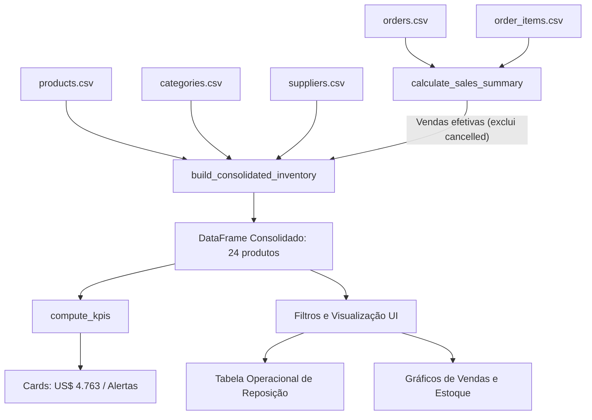

# SPEC — Software Specification

> **Objetivo:** transformar os requisitos do PRD em uma especificação técnica verificável, orientando a implementação modular e a validação do Dashboard de Estoque da Garden Shop através de abordagem combinada (SDD + TDD).
>
> **Documento de referência do SDD:** esta especificação é a fonte de verdade para os contratos técnicos, fórmulas matemáticas e critérios de validação.

## 1. Metadados

- **Projeto:** Dashboard de Gestão de Estoque e Reposição — Garden Shop
- **Versão da especificação:** 1.0
- **Status:** Approved
- **PRD relacionado:** `PRD.md`
- **Responsável pela aprovação:** Júlia Maria de Carvalho Vale
- **Data:** 2026-11-02

## 2. Objetivo técnico

Construir uma aplicação modular em Python com **Streamlit** (e bundle client-side via **Stlite** para GitHub Pages) que leia as bases relacionais da Garden Shop, consolide as informações no nível de granularidade de produto (1 linha por produto), aplique as regras de negócio de estoque e vendas sem duplicações, e exponha métricas, filtros e visualizações interativas.

## 3. Referências e rastreabilidade

| Requisito do PRD | Requisito da SPEC | Critério de validação / Teste |
| :--- | :--- | :--- |
| **RF-001** (Carregar dados CSV) | **REQ-001** (Pipeline de ingestão e tipagem) | `test_data_loader_loads_all_tables` |
| **RF-002** (Excluir cancelados) | **REQ-002** (Agregação de vendas efetivas) | `test_sales_calculation_excludes_cancelled` |
| **RF-003** (Valor de estoque a custo) | **REQ-003** (Cálculo contábil de estoque) | `test_total_inventory_value_equals_4763` |
| **RF-004** (Classificação de alerta) | **REQ-004** (Motor de regras de criticidade) | `test_alert_classification_categories` |
| **RF-005** (Descontinuados isolados) | **REQ-005** (Tratamento de produtos inativos) | `test_discontinued_product_has_no_reorder_alert` |
| **RF-006** (Déficit de reposição) | **REQ-006** (Fórmula de déficit de estoque) | `test_reorder_deficit_formula` |
| **RF-007** (Filtro por categoria) | **REQ-007** (Filtragem dinâmica de dados) | `test_filter_by_category` |
| **RF-008** (Junção com fornecedores) | **REQ-008** (Resolução de chaves e contato) | `test_supplier_join_and_missing_emails` |
| **RF-009** (Gráfico e visualização) | **REQ-009** (Renderização Streamlit/Stlite) | Teste de fumaça e inspeção visual da UI |

## 4. Escopo técnico

### 4.1. Incluído

- Módulo de dados e regras de negócio (`src/data_engine.py`): funções puras, testáveis e desacopladas da interface.
- Suíte de testes unitários com pytest (`tests/test_data_engine.py`).
- Interface do usuário Streamlit (`app.py`): visualização rica, KPIs, filtros laterais e tabelas estilizadas.
- Versão para GitHub Pages (`index.html`): distribuição web interativa utilizando Stlite (Streamlit montado sobre Pyodide/WebAssembly).
- Carregamento tolerante aos caminhos das bases (`Garden Shop - bases/` ou diretório local).

### 4.2. Excluído

- Dependência de banco de dados SQL externo ou backend de API dedicado.
- Mutação dos arquivos CSV de origem.

## 5. Arquitetura proposta

### 5.1. Visão geral e separação de responsabilidades

A aplicação adota separação clara entre lógica de negócio/dados e apresentação visual:
1. **Camada de Dados e Lógica (`src/data_engine.py`):**
   - Leitura de CSVs e normalização de tipos;
   - Agregação prévia de vendas válidas (eliminando cancelados);
   - Junção segura (*left joins*) para evitar multiplicação de linhas;
   - Cálculo de estoque, valor a custo, razão de reposição, déficit e status de alerta.
2. **Camada de Apresentação (`app.py` / `index.html`):**
   - Gestão de filtros interativos na barra lateral;
   - Renderização dos cartões de métricas (KPIs);
   - Exibição de tabelas com formatação condicional de criticidade;
   - Gráficos analíticos com Streamlit/Altair/Plotly.

### 5.2. Componentes

| Componente | Responsabilidade | Entradas | Saídas |
| :--- | :--- | :--- | :--- |
| `load_raw_data(data_dir)` | Lê os arquivos CSV e sanitiza tipos | Caminho do diretório de bases | Dicionário de DataFrames brutos |
| `calculate_sales_summary(orders_df, order_items_df)` | Agrega unidades e valor vendido por produto excluindo cancelados | DataFrames de pedidos e itens | DataFrame com `product_id`, `units_sold`, `revenue` |
| `build_consolidated_inventory(raw_data)` | Une produtos, categorias, fornecedores e vendas consolidadas | Dicionário de DataFrames | DataFrame final consolidado (exatamente 24 linhas) |
| `compute_kpis(consolidated_df)` | Extrai métricas agregadas globais | DataFrame consolidado | Dicionário com KPIs (Valor total, itens em alerta, etc.) |
| `filter_inventory(df, category, status_alerta)` | Aplica seletores do usuário | DataFrame e critérios | DataFrame filtrado para exibição |

### 5.3. Diagrama de fluxo de dados

## 6. Requisitos comportamentais

### REQ-001 — Ingestão e higienização das tabelas
- **Origem:** RF-001
- **Descrição:** O sistema deve ler os arquivos `products.csv`, `categories.csv`, `suppliers.csv`, `orders.csv` e `order_items.csv`.
- **Validação de tipos:** `discontinued` como booleano (`True`/`False`), preços e custos como ponto flutuante, quantidades e estoques como inteiros.
- **Tratamento de caminhos:** Se a pasta `Garden Shop - bases/` não existir, procurar no diretório corrente ou caminhos relativos de fallback.

### REQ-002 — Exclusão de pedidos cancelados
- **Origem:** RF-002 / RN-001
- **Regra:** Somente pedidos com `order_status != 'cancelled'` entram na agregação de vendas.
- **Caso de teste concreto:** O pedido `order_id = 17` possui status `cancelled` (1 unidade de *Pruning Shears*, US$ 22.00). Essa unidade não pode ser somada às vendas de *Pruning Shears*. As unidades totais vendidas na base devem ser exatamente **86 unidades** (65 shipped + 10 processing + 11 pending).

### REQ-003 — Cálculo do valor de estoque a custo
- **Origem:** RF-003 / RN-005
- **Fórmula:** $\text{inventory\_value} = \sum (\text{quantity\_on\_hand} \times \text{cost})$
- **Caso de teste concreto:** A soma de todos os 24 produtos cadastrados resulta em exatamente **US$ 4.763,00**. Produtos descontinuados (ex: *Bird Feeder*, 4 unid a US$ 8.50 = US$ 34.00) continuam compondo o valor imobilizado.

### REQ-004 — Regra de classificação de alertas de reposição
- **Origem:** RF-004 / RN-004
- **Lógica de classificação (para produtos ativos, `discontinued == False`):**
  1. Se $\text{quantity\_on\_hand} == 0 \implies$ **Ruptura** (Prioridade 1);
  2. Se $\frac{\text{quantity\_on\_hand}}{\text{reorder\_level}} < 0.5 \implies$ **Crítico** (Prioridade 2);
  3. Se $0.5 \le \frac{\text{quantity\_on\_hand}}{\text{reorder\_level}} < 1.0 \implies$ **Alerta** (Prioridade 3);
  4. Se $1.0 \le \frac{\text{quantity\_on\_hand}}{\text{reorder\_level}} \le 1.5 \implies$ **Observação** (Prioridade 4);
  5. Se $\frac{\text{quantity\_on\_hand}}{\text{reorder\_level}} > 1.5 \implies$ **Adequado** (Prioridade 5).
- **Produtos descontinuados:** Classificados obrigatoriamente como **Descontinuado** (sem recomendação de reposição).

### REQ-005 — Cálculo do déficit de reposição
- **Origem:** RF-006 / RN-006
- **Fórmula:**
  $$\text{deficit} = \begin{cases} 
  \text{reorder\_level} - \text{quantity\_on\_hand}, & \text{se } \text{discontinued} = \text{False e } \text{quantity\_on\_hand} < \text{reorder\_level} \\
  0, & \text{caso contrário}
  \end{cases}$$

### REQ-006 — Prevenção de duplicação em junções
- **Origem:** RNF-003
- **Garantia:** Como um produto pode aparecer múltiplas vezes em `order_items`, a tabela de vendas deve ser previamente agrupada por `product_id` antes da junção com `products`.
- **Resultado obrigatório:** O DataFrame consolidado deve ter **exatamente 24 registros** (número exato de produtos da base original).

## 7. Contratos de dados

### Modelo Consolidado (`consolidated_inventory`)

| Campo | Tipo | Descrição | Exemplo |
| :--- | :--- | :--- | :--- |
| `product_id` | int | Identificador único do produto | 1 |
| `product_name` | str | Nome descritivo do produto | "Tomato Seeds 'Roma'" |
| `category_id` | int | ID da categoria | 1 |
| `category_name` | str | Nome da categoria | "Seeds" |
| `supplier_id` | int | ID do fornecedor | 1 |
| `supplier_name` | str | Nome da empresa fornecedora | "GreenThumb Co." |
| `supplier_email`| str | E-mail para contato de compras | "orders@greenthumb.com" (ou "N/D") |
| `cost` | float | Preço de custo unitário | 1.20 |
| `price` | float | Preço de venda unitário | 2.50 |
| `quantity_on_hand`| int | Saldo físico atual em estoque | 3 |
| `reorder_level`| int | Nível mínimo para disparo de compra | 10 |
| `discontinued` | bool | Flag de descontinuidade do item | False |
| `units_sold` | int | Total de unidades vendidas em pedidos válidos | 5 |
| `total_cost_value`| float | Capital imobilizado (`quantity_on_hand * cost`) | 3.60 |
| `alert_status` | str | Classificação (Ruptura, Crítico, Alerta, etc.) | "Crítico" |
| `reorder_deficit`| int | Quantidade para atingir o nível | 7 |

## 8. Tratamento de exceções e valores ausentes

- **Fornecedores sem e-mail:** Fornecedores como *Ironwood Tools* e *RootWorks Supply* não possuem e-mail cadastrado. O sistema deve preencher com `"Não informado"` ou `"N/D"`, sem quebrar a interface nem exibir valores nulos (`NaN`/`None`).
- **Produtos sem vendas:** Produtos como *Hanging Basket* e *Bird Feeder* não possuem pedidos associados. O sistema deve preencher `units_sold = 0`, evitando valores nulos.
- **Filtros sem resultados:** Caso o usuário selecione uma categoria sem produtos no status filtrado, a interface deve exibir mensagem informativa amigável: *"Nenhum produto encontrado com os filtros selecionados."*

## 9. Plano de implementação e estratégia de testes (TDD)

### Ordem de desenvolvimento:
1. **Fase 1 (Testes e Core de Dados):**
   - Criação dos testes unitários em `tests/test_data_engine.py` validando os valores da base de dados conhecida;
   - Implementação de `src/data_engine.py` até que todos os testes passem com 100% de sucesso.
2. **Fase 2 (Interface Streamlit Local):**
   - Construção de `app.py` com métricas em cards, filtros reativos e tabelas formatadas;
   - Validação local e geração de evidência/print do dashboard ativo.
3. **Fase 3 (Versão Web GitHub Pages via Stlite):**
   - Criação de `index.html` estático empacotando o Streamlit com Stlite/Pyodide e os dados da Garden Shop para publicação direta no GitHub Pages.
